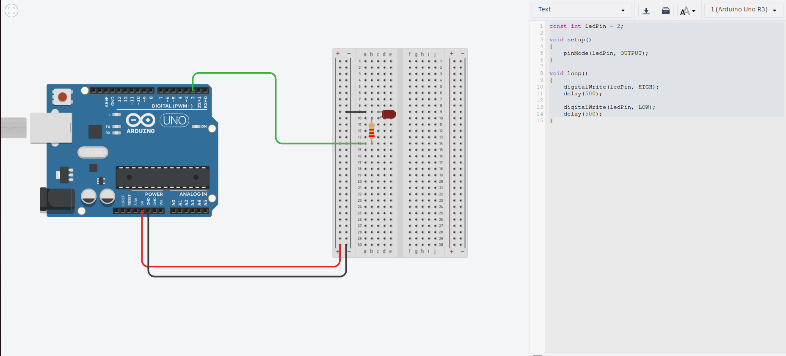

# [20261114] Robotics AI 실습 보고서 - 디지털 출력 기반 LED 점멸 제어

* **학과:** 컴퓨터공학부 (컴퓨터공학전공)
* **학번:** 202235357
* **이름:** 현경훈
* **제출일:** 2026-11-18

---

## 실습 목차 (Summary)

| 번호 | 실습 주제 | 사용 보드 / 환경 | 핵심 이론 및 기술 |
| :---: | :--- | :--- | :--- |
| **Ex 1** | LED 점멸 제어 (Blink) | Arduino Uno (Tinkercad) | GPIO Digital Output, 옴의 법칙 ($V = IR$) |

---

## 1. [실습 1] LED 점멸 제어 (Blink)

### 1.1 실습 수행 과정
* **실습 목표:** Tinkercad 시뮬레이터를 활용하여 디지털 출력(GPIO) 기반의 LED 점멸(Blink) 동작 구현
* **회로 구성:**
  * Tinkercad에 로그인 후 새로운 Circuit 프로젝트를 생성하고 **Arduino Uno** 보드와 **브레드보드** 배치
  * **전원 라인 연결:** 빨간색 와이어로 Arduino `5V` 핀을 브레드보드 `(+)` 전원 라인에, 검은색 와이어로 `GND` 핀을 `(-)` 전원 라인에 연결
  * **소자 배치 및 배선:**
    * LED의 음극(짧은 다리)을 브레드보드의 `(-)` 전원 라인에 연결
    * Arduino `D2` (`pin #2`)와 `220Ω` 저항을 LED의 양극(긴 다리)에 직렬로 연결
* **알고리즘 설계:**
  * LED가 주기적으로 깜빡이는 동작을 구현하기 위해 `HIGH(ON)` 상태와 `LOW(OFF)` 상태 사이에 각각 `0.5초(500ms)` 딜레이를 배치하는 순차 제어 로직 설계
* **코드 구현 및 디버깅:**
  * **전역 변수 선언:** LED와 연결된 `pin #2` 를 상수형 변수(`const int ledPin = 2;`)로 선언
  * **`setup()` (초기화 루틴):** 실행 초반 1회 실행되며, `pinMode(ledPin, OUTPUT);` 을 통해 `pin #2` 를 디지털 출력(`OUTPUT`) 모드로 지정
  * **`loop()` (메인 제어 루프):** 무한 반복(Super Loop) 구조 내에서 `digitalWrite()` 함수로 `pin #2` 에 `HIGH(5V)` 와 `LOW(0V)` 값을 교차 인가하고, 각 상태마다 `delay(500);` (`500ms`) 호출
  * **디버깅:** `220Ω` 보호 저항을 직렬 연결하여 정상 전류 범위 내에서 안정적으로 동작하도록 구성
* **테스트 및 검증:**
  * Tinkercad 시뮬레이션 실행 후 `0.5초` 간격으로 LED가 정상 점등 및 소등됨을 검증

### 1.2 적용된 이론 및 기술
* **GPIO 디지털 출력 제어:** 논리 전압(`HIGH`: 5V, `LOW`: 0V)을 부하하여 구동
* **옴의 법칙 (V = IR) 및 전류 제한:** LED에 적정 전류를 인가하기 위하여 저항(`220Ω`)을 직렬로 연결

### 1.3 구현 결과


* **결과 분석:** 시뮬레이션 실행 후 의도한 대로 `0.5초` 간격(주기 `1.0초`)으로 LED가 안정적으로 점등 및 소등됨을 확인

---

## 2. 필수 의존성 및 환경 설정 (Dependencies & Environment)

* **시뮬레이터 / 개발 환경:**
  * Autodesk Tinkercad Circuits (웹 브라우저 기반 시뮬레이션 환경)
* **사용한 가상 하드웨어 요소:**
  * Arduino Uno, 브레드보드, LED, 220Ω 저항
* **필수 라이브러리:**
  * Arduino 표준 코어 내장 함수

---

## 3. 제출 파일 구성 및 실행 방법 (File Structure & How to Run)

### 3.1 디렉토리 구조
```text
├── README.md                    # 실습 결과 보고서
├── led_test.ino                 # [실습 1] LED 점등 테스트 코드
└── tinkercad_led_practice.png   # [실습 1] Tinkercad 작업 캡처 화면
```

### 3.2 실행 방법
1. [Tinkercad](https://www.tinkercad.com) 홈페이지에 접속하여 로그인 후 새 Circuit 생성
2. 상단 **1.1 실습 수행 과정** 및 `tinkercad_led_practice.png` 캡처 화면을 참고하여 회로 구성
3. 우측 상단 **[코드]** 버튼을 누르고 **[편집 모드]** 를 **[문자]** 로 변경한 뒤 `led_test.ino` 코드 입력
4. 우측 상단 **[▶ 시뮬레이션 시작]** 버튼을 눌러 동작 확인

---

## 4. 기타 참고 사항 (Notes & References)

* **주의 사항:** 브레드보드 배선 시 LED의 극성(양극: 꺾여 있는 긴 다리, 음극: 짧은 다리)에 주의하여 연결