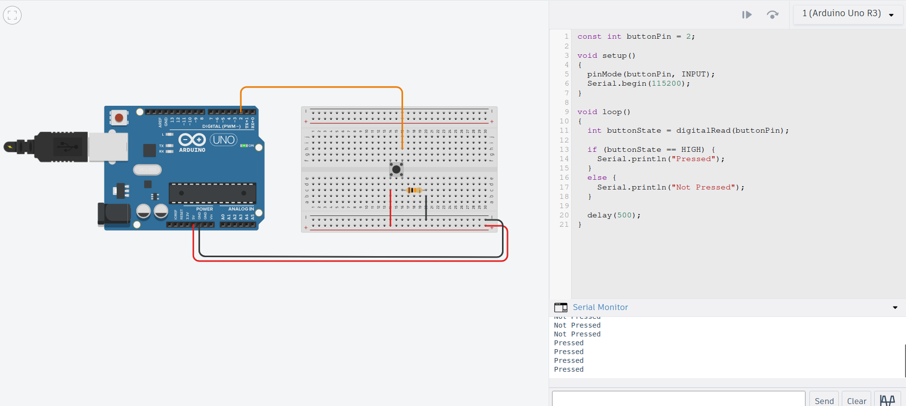
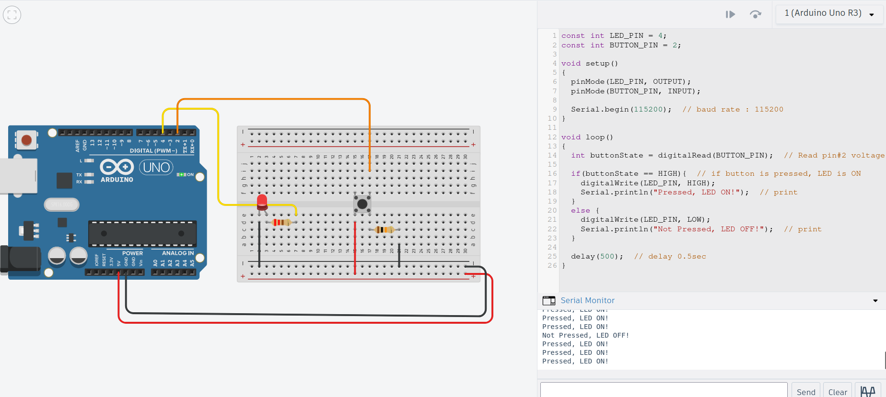
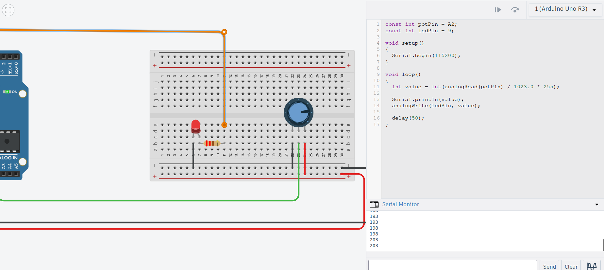

# [20261115] Robotics AI 실습 보고서 - 디지털/아날로그 입출력 및 액추에이터 제어

* **학과:** 컴퓨터공학부 (컴퓨터공학전공)
* **학번:** 202235357
* **이름:** 현경훈
* **제출일:** 2026-11-18

---

## 실습 목차 (Summary)

| 번호 | 실습 주제 | 사용 보드 / 환경 | 핵심 이론 및 기술 |
| :---: | :--- | :--- | :--- |
| **Ex 1** | 푸시 버튼 입력 시리얼 모니터링 | Arduino Uno (Tinkercad) | Digital Input, 풀다운(Pull-down) 저항, Serial 통신 |
| **Ex 2** | 푸시 버튼 입력 기반 LED 제어 | Arduino Uno (Tinkercad) | Digital I/O |
| **Ex 3** | 가변저항(Potentiometer) LED 밝기 제어 | Arduino Uno (Tinkercad) | 10-bit ADC, 8-bit PWM(`analogWrite`), 스케일링 |
| **Ex 4** | 서보모터 자동 왕복(Sweep) 제어 | ESP32 | PWM 각도 제어, `ESP32Servo` 라이브러리 |
| **Ex 5** | 가변저항 기반 서보모터 실시간 각도 제어 | ESP32 | 12-bit ADC(0~4095), `map()` 함수 매핑 제어 |

---

## 1. [실습 1] 푸시 버튼 입력 시리얼 모니터링

### 1.1 실습 수행 과정
* **실습 목표:** 푸시 버튼의 누름 상태를 디지털 입력으로 읽어 시리얼 모니터에 실시간 출력
* **회로 구성:**
  * Arduino `5V` 및 `GND` 를 브레드보드의 `(+)` / `(-)` 전원 라인에 연결
  * 푸시 버튼의 한쪽 단자를 `5V(+)` 에 연결하고
  * 반대쪽 대각선 위 단자를 Arduino `D2` 핀 연결
  * `D2` 핀에 연결한 단자의 아래 단자를 10kΩ 저항으로 풀다운(Pull-Down)을 거쳐 `GND(-)` 에 연결
* **코드 구현 및 디버깅:**
  * `setup()` 에서 `pinMode(buttonPin, INPUT);` 으로 `D2` 핀을 입력 모드로 설정
  * `Serial.begin(115200);`을 통해 baud rate를 115200로 시리얼 통신 초기화
  * `loop()` 에서 `digitalRead(buttonPin)` 으로 전압 상태를 읽어 `HIGH` 일 때 `"Pressed"`, `LOW` 일 때 `"Not Pressed"` 를 `500ms` 주기로 출력
  * **디버깅:** 미입력 시 핀이 플로팅(Floating) 상태가 되어 노이즈가 발생하는 것을 방지하기 위해 풀다운 저항 회로를 구성하여 평상시 `LOW` 전위를 안정적으로 유지함

### 1.2 적용된 이론 및 기술
* **풀다운 저항(Pull-down Resistor):** 스위치가 열려 있을 때 입력 핀을 `GND` 로 연결해 `0V(LOW)` 논리 상태를 보장하는 회로 설계 기법
* **시리얼 통신:** `115200 bps` 보드레이트로 마이크로컨트롤러의 상태 데이터를 PC 시리얼 모니터로 전송

### 1.3 구현 결과

* **결과 분석:** 버튼을 누르지 않은 상태에서는 `"Not Pressed"` 가 출력되다가, 버튼을 누르는 순간 `"Pressed"` 로 즉시 전환됨을 확인

---

## 2. [실습 2] 푸시 버튼 입력 기반 LED 제어

### 2.1 실습 수행 과정
* **실습 목표:** 실습 1의 버튼 입력 회로에 LED 출력 회로를 결합하여 버튼 누름 여부에 따른 LED 점등 제어 구현
* **회로 구성:**
  * 버튼 입력부(`D2` 핀 및 풀다운 저항) 구성
  * LED의 양극(긴 다리)을 전류 제한 저항을 거쳐 Arduino `D4` 핀에 연결하고, 음극(짧은 다리)을 `GND(-)` 에 연결
* **코드 구현 및 디버깅:**
  * `LED_PIN(4)` 은 `OUTPUT` 으로, `BUTTON_PIN(2)` 는 `INPUT` 으로 초기화
  * `buttonState == HIGH` 조건일 때 `digitalWrite(LED_PIN, HIGH)` 로 LED를 켜고 `"Pressed, LED ON!"` 출력, 그 외에는 `LOW` 로 끄고 `"Not Pressed, LED OFF!"` 출력 (`500ms` 주기)
  * **디버깅:** 시리얼 모니터에 결과 출력

### 2.2 적용된 이론 및 기술
* **GPIO 입출력 연동:** 스위치를 디지털 신호로 입력 받은 뒤 조건문을 통해 출력 장치(LED)를 구동하는 구조

### 2.3 구현 결과

* **결과 분석:** 버튼을 누를 때만 빨간색 LED가 점등되며 시리얼 모니터 출력과 LED의 물리적 상태가 일치함을 검증

---

## 3. [실습 3] 가변저항(Potentiometer) LED 밝기 제어

### 3.1 실습 수행 과정
* **실습 목표:** 가변저항의 아날로그 전압 변화를 읽어 PWM 신호로 변환함으로써 LED 밝기를 연속적으로 조절
* **회로 구성:**
  * 가변저항의 양 끝 단자를 `5V(+)` 와 `GND(-)` 에 연결하고, 가운데 가변 단자(Wiper)를 Arduino 아날로그 입력 핀 `A2` 에 연결
  * LED 양극을 직렬 저항과 함께 PWM 지원 디지털 핀 `D9` (`~9`)에 연결
* **코드 구현 및 디버깅:**
  * `analogRead(potPin)` 으로 `0~1023` 범위의 10-bit 아날로그 값을 수신
  * `int(analogRead(potPin) / 1023.0 * 255)` 수식을 적용해 8-bit PWM 출력 범위(`0~255`)로 정규화 및 Float형에서 INT형으로 형변환
  * `analogWrite(ledPin, value)` 를 호출해 LED 밝기를 제어하고 `50ms` 간격으로 시리얼 모니터에 변환된 값 출력
  * **디버깅:** 정수 나눗셈(`1023`) 시 몫이 `0` 으로 절삭되는 문제를 방지하기 위해 실수 리터럴(`1023.0`)을 사용하여 부동소수점 연산 후 정수형으로 변환

### 3.2 적용된 이론 및 기술
* **ADC (Analog-to-Digital Conversion):** 연속적인 아날로그 전압(`0~5V`)을 Arduino Uno의 10-bit(`0~1023`) 디지털 값으로 변환
* **PWM (Pulse Width Modulation):** 디지털 핀에서 펄스의 듀티 사이클(Duty Cycle, `0~255`)을 조절하여 평균 인가 전력을 변화시킴으로써 LED 밝기를 제어

### 3.3 구현 결과

* **결과 분석:** 가변저항 노브를 회전시킴에 따라 시리얼 모니터의 출력값이 변화하며 LED의 발광 밝기가 부드럽게 증감함을 확인

---

## 4. [실습 4] 서보모터 자동 왕복(Sweep) 제어 (ESP32)

### 4.1 실습 수행 과정
* **실습 목표:** ESP32 보드에서 `ESP32Servo` 라이브러리를 활용해 서보모터를 `0°` 에서 `180°` 까지 왕복 회전시키는 제어 로직 구현
* **회로 구성:**
  * ESP보드의 5V와 GND, GPIO 14번 핀을 서보 모터와 연결(**5V-빨간색**, **GND-갈색**, **GPIO 14-주황색**)
* **코드 구현:**
  * `ESP32Servo.h` 헤더를 포함하고 `Servo` 객체(`myServo`) 생성
  * `setup()` 에서 `SERVO_PIN(GPIO 14)` 에 서보 객체를 할당(`attach`)하고 초기 각도를 `0°` 로 설정
  * `loop()` 내 두 개의 `for` 반복문을 통해 `degree` 변수를 `1` 씩 증가(`0° -> 180°`) 및 감소(`180° -> 0°`)시키며 `5ms` 간격으로 `myServo.write(degree)` 호출

### 4.2 적용된 이론 및 기술
* **서보모터 PWM 각도 제어:** `Servo.write()`함수에 각도값(0~180)을 인자로 넣으면 PWM 제어 신호로 내부에서 변환을 통해 목표 각도(`0°~180°`)로 위치 제어 수행

---

## 5. [실습 5] 가변저항 기반 서보모터 실시간 각도 제어 (ESP32)

### 5.1 실습 수행 과정
* **실습 목표:** ESP32의 12-bit ADC로 가변저항 값을 읽어 서보모터의 회전 각도(`0°~180°`)를 실시간으로 매핑 제어
* **회로 구성:**
  > 서보 모터 접촉 불량 문제로 점퍼선을 이용하여 호환 보드의 가변저항 사용
  * ESP보드의 5V와 GND, GPIO 14번 핀을 서보 모터와 연결
  * ESP보드의 **3.3V**와 GND, GPIO 39핀을 점퍼 케이블로 호환 보드와 연결
* **코드 구현 및 디버깅:**
  * `POT_PIN(GPIO 39)` 에서 `analogRead()` 로 `0~4095` 범위의 아날로그 값을 수집
  * `map(value, 0, 4095, 0, 180)` 함수를 사용하여 입력 범위를 서보모터 구동 각도 범위로 변환
  * **디버깅:** 시리얼 모니터로 원시 ADC 값을 출력하면서 `myServo.write(degree)` 로 `5ms` 주기의 실시간 각도 변환 수행

### 5.2 적용된 이론 및 기술
* **ESP32 12-bit ADC:** Arduino Uno(10-bit, `0~1023`)와 달리 ESP32는 12-bit(`0~4095`) 해상도를 가지므로, 이에 맞춘 스케일링 파라미터를 적용
* **매핑 (`map()`):** 입력 구간 [0, 4095]의 값을 출력 구간 [0, 180]으로 비례 변환하여 직관적인 위치 제어 구현

---

## 6. 필수 의존성 및 환경 설정 (Dependencies & Environment)

* **시뮬레이터 / 개발 환경:**
  * 실습 1~3: Autodesk Tinkercad Circuits (Arduino Uno)
  * 실습 4~5: Arduino IDE / ESP32 개발 보드
* **필수 라이브러리:**
  * 실습 1~3: Arduino 표준 코어 내장 함수
  * 실습 4~5: **`ESP32Servo`** 라이브러리 (Arduino Library Manager를 통해 설치)

---

## 7. 제출 파일 구성 및 실행 방법 (File Structure & How to Run)

### 7.1 디렉토리 구조
```text
├── README.md                                  # 통합 실습 결과 보고서
├── exercise_button_code.ino                   # [실습 1] 버튼 입력 시리얼 출력 코드
├── exercise_button_and_led_code.ino           # [실습 2] 버튼 입력 LED 제어 코드
├── exercise_potentiometer_and_led_code.ino    # [실습 3] 가변저항 LED 밝기 제어 코드
├── exersice_servo_swip_code.ino.ino           # [실습 4] ESP32 서보모터 왕복 제어 코드
├── exercise_potentiometer_and_servo_code.ino  # [실습 5] ESP32 가변저항 서보모터 제어 코드
├── exercise_button_image.png                  # [실습 1] Tinkercad 실행 결과 캡처
├── exercise_button_and_led_image.png          # [실습 2] Tinkercad 실행 결과 캡처
└── exercise_potentiometer_and_led_image.png   # [실습 3] Tinkercad 실행 결과 캡처
```

### 7.2 실행 방법
* **실습 1 ~ 3 (Tinkercad 시뮬레이션):**
  1. [Tinkercad](https://www.tinkercad.com) 접속 후 새 Circuit 생성
  2. 각 실습 결과 캡처 이미지(`exercise_*.png`)를 참고하여 브레드보드 배선 구성
  3. 우측 상단 **[코드] → [문자]** 모드에서 해당 `.ino` 소스 코드를 입력하고 **[시뮬레이션 시작]** 클릭
  4. 하단 **[Serial Monitor]** 패널을 열어 출력 로그 확인
* **실습 4 ~ 5 (ESP32 하드웨어):**
  1. Arduino IDE에서 `ESP32Servo` 라이브러리 설치 후 보드를 ESP32 모델로 선택
  2. 신호선을 `GPIO 14` (서보모터), `GPIO 39` (가변저항)에 연결한 뒤 코드 업로드 실행

---

## 8. 기타 참고 사항 (Notes & References)

* **주의 사항:**
  * Arduino Uno(`10-bit ADC`, `0~1023`)와 ESP32(`12-bit ADC`, `0~4095`)의 아날로그 입력 해상도가 다르므로 코드 이식 시 매핑 최댓값 수정이 필요
  * ESP32의 아날로그 입력 핀(GPIO 39)은 최대 허용 전압과 12-bit ADC(0~4095) 기준 전압이 모두 3.3V이므로 가변저항을 사용하기 위해서 호환보드를 점퍼선으로 연결할 때 3.3V에 연결해야 함을 주의